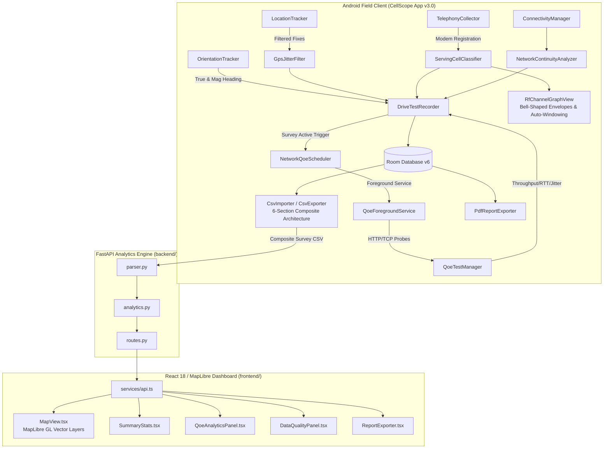

# CellScope 5G — Next-Gen Cellular Field Analytics, Automated QoE & Coverage Intelligence (v3.0)

[](LICENSE)
[](#platform-architecture)
[](#what-is-new-in-version-30)
[](CellScope-v3.0.apk)
[](CellScope-v2.0-final.apk)
[](docs/CellScope_5G_v3_Technical_Report.pdf)

**CellScope 5G** is an enterprise-grade cellular field-testing, RF optimization, and multi-generation network intelligence platform engineered for Radio Access Network (RAN) engineers, RF planning specialists, and field drive-test technicians. It pairs a **native Kotlin Android field application** with an **asynchronous FastAPI post-processing microservice** and an **interactive MapLibre GIS web dashboard** for deep post-processing and drive-test evaluation.

📄 **Comprehensive Technical Specification:** Read the complete 5-page publication-grade PDF report at [`docs/CellScope_5G_v3_Technical_Report.pdf`](docs/CellScope_5G_v3_Technical_Report.pdf).

---

## Latest Android APK — v3.0

📦 **Download Latest Release:** [`CellScope-v3.0.apk`](CellScope-v3.0.apk) (~48.9 MB, verified build)

* **Version:** `v3.0.0-production` (Build 2026.10, API 26–35)
* **Build Variant:** Debug (`assembleDebug`) — signed with the standard Android debug keystore for seamless installation on test devices and developer handsets without requiring custom release key provisioning.
* **Core v3.0 Features & Upgrades:**
  * **Automated Survey QoE Engine:** Automatically starts bounded active download/upload throughput, RTT, jitter, and probe loss tests upon survey start; configurable 5m/10m/custom intervals with Foreground Service persistence; removed the legacy 50 MB daily cap.
  * **Restored RF Frequency Graph:** Smooth cubic Bézier bell-shaped channel envelopes with multi-band smart auto-windowing, standard telecom dynamic bounds (-140 to -40 dBm), 16dp minimum visual half-width, interactive touch inspection, and dual-theme adaptive styling.
  * **6-Section Multi-CSV Engine:** Resilient multi-section survey parser and exporter (`[SURVEY_METADATA]`, `[TELEMETRY_SAMPLES]`, `[ACTIVE_QOE_TESTS]`, `[MOBILITY_EVENTS]`, `[SERVICE_HOLES]`, `[ESTIMATED_TOWERS]`).
  * **3GPP TS 45.005 GSM ARFCN Classification:** Precise discrimination of P-GSM 900, E-GSM 900, GSM 850, and DCS 1800.
  * **LTE CRS Modulo-3 & Reuse Analytics:** Hexagonal reuse distance ($D = R\sqrt{3N}$) and CRS subcarrier collision analysis ($v_{\text{shift}} = N_{\text{ID}}^{\text{cell}} \bmod 3$).
  * **Evidence-Based Traffic Intelligence:** Real-time sector congestion classification and stronger neighbor ("Why Not Connected?") diagnostics.

### Android Installation Instructions
1. Download [`CellScope-v3.0.apk`](CellScope-v3.0.apk) directly to your Android device (or install via ADB: `adb install -r CellScope-v3.0.apk`).
2. Open your device's **Files** or **Downloads** app and tap `CellScope-v3.0.apk`.
3. If prompted by Android system security, enable **"Install unknown apps"** / **"Allow from this source"** for your browser or file manager.
4. Tap **Install** (or **Update** if updating from a prior installation).
5. Grant the requested runtime permissions on initial launch:
   - **Location (Allow all the time / While in use):** Required for GNSS drive-test route tracking.
   - **Phone / Read Phone State:** Required for raw physical-layer telephony signal metrics and carrier frequency resolution.
   - **Notifications:** Required for the ongoing survey & QoE background Foreground Service.

### Historical Archive
* 📦 **Version 2.0 (Historical Final):** [`CellScope-v2.0-final.apk`](CellScope-v2.0-final.apk) (~48.3 MB) — preserved as a historical reference artifact for backward-compatibility audits.

---

## What is New in Version 3.0 (Major Release)

### 1. Automated Active Network QoE Testing with Survey Recording
* **Zero-Touch Background Loop:** Starting a survey recording automatically triggers an initial bounded QoE test (HTTP/TCP download/upload throughput, RTT median/mean/P95, RFC 3550 jitter, and probe loss).
* **Configurable Intervals:** Supports 5-minute, 10-minute (default), and custom scheduling intervals. Tests run in an Android Foreground Service (`QoeForegroundService`) with ongoing notification to prevent Doze-mode termination.
* **Removal of Hardcoded Caps:** Eliminated the legacy 50 MB daily cap, replacing it with user-configurable per-test limits, cumulative data caps, and safe cellular roaming safeguards.
* **Robust Lifecycle Management:** Pausing a survey gracefully halts the scheduler; resuming triggers the next bounded test without worker duplication; stopping the survey cleanly terminates services while strictly preserving all completed test results in Room SQLite.

### 2. Restored Bell-Shaped RF Channel Frequency Graph
* **Smooth Bell-Shaped Envelopes:** Renders continuous cubic Bézier channel curves for serving and neighbor cells, derived from 3GPP nominal bandwidth allocations and center frequencies.
* **Multi-Band Smart Auto-Focus Windowing:** When "All Bands" is active and observed cells span multiple distant bands (> 60 MHz, e.g. Band 8 at 940 MHz and Band 3 at 1850 MHz), the viewport automatically windows onto the active serving cell's band, preventing extreme multi-band compression distortion. Horizontal filter chips (`All`, `B1`, `B3`, `B8`, `B28`, `B40`) allow instant manual band switching.
* **Minimum Visual Half-Width:** Enforces `halfWidthPx = max(nominalHalfWidthPx, 16f * density)`, guaranteeing that narrow channels (GSM 200 kHz, LTE 1.4 MHz) render prominent, legible envelopes.
* **Standard Telecom Dynamic Range:** Fixed Y-axis limits from **-140 dBm to -40 dBm** with 20 dB gridlines (-140, -120, -100, -80, -60, -40 dBm), eliminating vertical viewport jumping and clipped labels.
* **Touch Hit-Testing & Inspection:** Tapping any envelope displays an amber glowing peak ring, vertical leader line, and callout pill, while updating the *Cell Carrier Inspection* card with duplex separation, bandwidth, RSRP, RSRQ, and SINR.
* **Adaptive Theme Support:** Clean high-contrast rendering across Light theme (soft slate grid, dark labels) and Dark theme (subtle slate grid, light labels, glowing primary blue envelopes).
* **3GPP Standards Disclosure:** Clear on-screen disclaimer: *"Visualized Channel Signal Distribution (Derived from 3GPP channel allocation; not calibrated spectral power)"*.

### 3. Multi-Section Schema-Aware CSV Engine & Audit Fixture
* **6-Section Composite CSV:** Independently parses and validates `[SURVEY_METADATA]`, `[TELEMETRY_SAMPLES]`, `[ACTIVE_QOE_TESTS]`, `[MOBILITY_EVENTS]`, `[SERVICE_HOLES]`, and `[ESTIMATED_TOWERS]`.
* **Resilient Importer:** Validates each section against its own schema, reporting malformed rows with exact section names and line numbers without discarding valid telemetry samples.
* **Historical Session Export:** Exports the explicitly selected historical survey session rather than the currently active recording.
* **End-to-End Regression Fixture:** Backed by automated regression tests using genuine highway survey data (`docs/cellscope_extended_Survey_20261020_050657_20261020_050657.csv`).

### 4. 3GPP TS 45.005 GSM ARFCN Band Classification
* **Accurate Band Discrimination:** Strictly separates P-GSM 900 (ARFCN 1..124), E-GSM 900 (ARFCN 0, 975..1023), GSM 850 (ARFCN 128..251), and DCS 1800 (ARFCN 512..885).
* **Metric Provenance:** Distinguishes GSM RxLev/RSSI from LTE RSRP/RSRQ and 5G SS-RSRP/SS-RSRQ, preventing cross-generation metric conflation.

### 5. LTE CRS Modulo-3 Interference & Cellular Frequency Reuse
* **LTE CRS Shift Isolation:** Restricts cell-specific reference signal (CRS) subcarrier collision analysis strictly to LTE networks ($v_{\text{shift}} = N_{\text{ID}}^{\text{cell}} \bmod 3$), excluding 5G NR and 2G GSM.
* **Hexagonal Reuse Analytics:** Computes theoretical co-channel reuse distance ($D = R\sqrt{3N}$) and co-channel reuse ratio ($Q = \sqrt{3N}$).
* **Empirical Radius Calculation:** Derives empirical cell radius ($R$) from continuous GPS drive-test trajectories using the Haversine formula, with safeguards against insufficient spatial evidence.

### 6. Evidence-Based Traffic Intelligence & Congestion Diagnostics
* **Multi-Scale Traffic Estimation:** Detects cell sector congestion by correlating high RSRP (> -90 dBm) with depressed RSRQ (< -14 dB) and degraded throughput (< 2.0 Mbps).
* **Stronger Neighbor Intelligence ("Why Not Connected?"):** Evaluates delta RSRP ($\Delta \text{RSRP} \ge +6.0\text{ dB}$) against neighbor sectors to diagnose handover ping-pong, CIO bias, or missing neighbor relations.

### 7. Laptop Web Dashboard v3.0 Feature Parity & Multi-Layer GIS Synchronization
* **Refactored Header & Responsive Navigation:** Clean "CellScope 5G" branding, "v3.0 Production" badge, responsive max-width layout (`max-w-[1720px]`), and adaptive navigation tabs with dual short/full label breakpoints (`shortLabel` on 1280–1440px laptop displays, `fullLabel` on ≥ 1440px displays), completely eliminating tab clipping, wrapping, and horizontal scrollbars.
* **Multi-Layer Map Overlay Engine:** Leaflet GIS integration with dedicated layer groups and instant visibility controls:
  * **Metric Points Layer:** Physical radio measurements with color scales for `RSRP (dBm)`, `RSRQ (dB)`, `CINR / SINR (dB)` (clarifying telecom nomenclature), `PCI Mod-3 Shift`, `TA Range`, and `Speed (km/h)`.
  * **Survey Route Track:** Continuous glowing directional polyline tracing GPS fixes in chronological order.
  * **Weak Coverage Zones Corridors:** Contiguous weak coverage corridors (RSRP < -105 dBm) highlighted with amber/orange polylines and fade inspection markers.
  * **Handover Transition Badges:** Elevated diamond markers at serving cell handoffs with `from PCI → to PCI` tooltip diagnostics and timestamp provenance.
  * **Estimated Cell Sites:** Tower centroid locations estimated from RF power-weighted triangulation ($\sum w_i \mathbf{x}_i / \sum w_i$ where $w_i = 10^{\text{RSRP}_i/10}$) with antenna icons and dashed coverage/uncertainty circles.
  * **Timing Advance (TA) Range:** Range uncertainty circles derived from $d \approx \text{TA} \times 78.12\text{ meters}$.
* **Advanced Slide-over Telecom Filter Drawer:** Comprehensive multi-parameter filtering by Serving PCI, RAT Generation (`5G NR`, `4G LTE`, `3G UMTS`, `2G GSM`), Network Operator, Carrier Frequency / EARFCN, Signal Quality classes, Handover-only, and Weak-zone-only toggles. Filter selections dynamically recompute map layers, session KPIs, distributions, and data tables.
* **3GPP TS 36.101 Carrier & Band Inventory:** Instant calculation of downlink ($F_{\text{DL}}$) and uplink ($F_{\text{UL}}$) center frequencies from detected EARFCNs, paired with duplex mode (FDD/TDD) and Bangladesh operator allocations.
* **LTE CRS Modulo-3 Interference Grouping:** Automatic grouping of observed PCIs by $v_{\text{shift}} = \text{PCI} \bmod 3$ with co-channel collision risk warnings.

---

## Mathematical Formulations

### 1. LTE Reference Signal Metrics
$$\text{RSRQ} = \frac{N \cdot \text{RSRP}}{\text{RSSI}} \implies \text{RSRQ}_{\text{dB}} = 10\log_{10}(N) + \text{RSRP}_{\text{dBm}} - \text{RSSI}_{\text{dBm}}$$
where $N$ is the number of downlink Resource Blocks across the carrier channel bandwidth.

### 2. LTE CRS Modulo-3 Subcarrier Shift
$$v_{\text{shift}} = N_{\text{ID}}^{\text{cell}} \bmod 3 = (3 \cdot N_{\text{ID}}^{(1)} + N_{\text{ID}}^{(2)}) \bmod 3 = N_{\text{ID}}^{(2)} \in \{0, 1, 2\}$$

### 3. Hexagonal Co-Channel Reuse Distance & Radius
$$D = R \cdot \sqrt{3N}, \quad Q = \frac{D}{R} = \sqrt{3N}$$
where empirical radius $R$ is calculated via Haversine distance:
$$\mathcal{H}(\phi_1, \lambda_1, \phi_2, \lambda_2) = 2R_{\text{Earth}} \arcsin \sqrt{\sin^2\left(\frac{\Delta\phi}{2}\right) + \cos\phi_1\cos\phi_2\sin^2\left(\frac{\Delta\lambda}{2}\right)}$$

### 4. 3GPP Downlink Carrier Frequency Raster
* **LTE (3GPP TS 36.101):**
  $$F_{\text{DL}} = F_{\text{DL\_low}} + 0.1 \cdot (N_{\text{DL}} - N_{\text{Offs\_DL}})$$
* **5G NR (3GPP TS 38.101-1):**
  $$F_{\text{REF}} = \begin{cases} 0.005 \cdot N_{\text{REF}} & N_{\text{REF}} \in [0, 599999] \\ 3000.0 + 0.015 \cdot (N_{\text{REF}} - 600000) & N_{\text{REF}} \in [600000, 2016666] \end{cases}$$
* **GSM (3GPP TS 45.005):**
  $$F_{\text{DL}}(n) = \begin{cases} 935.0 + 0.2 \cdot n & n \in [1, 124] \quad (\text{P-GSM 900}) \\ 925.0 + 0.2 \cdot (n - 1024) & n \in [975, 1023] \quad (\text{E-GSM 900}) \\ 1805.2 + 0.2 \cdot (n - 512) & n \in [512, 885] \quad (\text{DCS 1800}) \end{cases}$$

---

## System Architecture



---

## Technical Stack

| Component | Technology Stack |
| :--- | :--- |
| **Android OS & SDK** | Android 8.0+ (API 26 to 35), Native Kotlin 2.0 |
| **Android Architecture** | Clean Architecture / MVVM with StateFlow, Coroutines, Foreground Services |
| **Database** | Android Room Database v6 (KSP) with non-destructive migrations |
| **Map Rendering** | MapLibre Native Android SDK (11.5.1) with keyless OpenStreetMap tiles |
| **RF Visualization** | Custom `RfChannelGraphView` with cubic Bézier bell envelopes & touch hit-testing |
| **Document Generation**| Android `PdfDocument` paginated canvas engine & Python ReportLab A4 generator |
| **Backend API** | Python 3.11+, FastAPI 0.136, Pydantic v2, AnyIO, Uvicorn, Pytest |
| **Frontend Web** | React 18, Vite 8, TypeScript, Tailwind CSS, MapLibre GL, Lucide Icons, Chart.js |

---

## Verification & Test Results

All verification suites have been executed and verified in place:

* **Android Unit Tests:** **272 / 272 Passed** (100% success rate across 52 test suites via `.\android\gradlew.bat testDebugUnitTest` in 50s, 0 failures).
* **Android Debug APK Assembly:** **BUILD SUCCESSFUL** via `assembleDebug` (`CellScope-v3.0.apk` ~48.9 MB / 51,231,052 bytes).
* **FastAPI Backend Analytics:** **20 / 20 Passed** (`python -m pytest backend/tests`, 0 failures).
* **Frontend Production Build:** **BUILD SUCCESSFUL** (`npm run build`, 1,934 modules transformed in 0.97s, 0 errors).
* **Frontend Static Code Quality:** **0 Warnings, 0 Errors** (`npm run lint` via oxlint).
* **End-to-End CSV Regression:** **100% Passed** (`MultiSectionCsvRegressionTest` validating 6-section survey dataset).

---

## Getting Started

### 1. Direct Android Installation
Transfer [`CellScope-v3.0.apk`](CellScope-v3.0.apk) to an Android device (API 26+) or install via ADB:
```bash
adb install -r CellScope-v3.0.apk
```

### 2. Building from Source
```bash
# Set JDK 21+ environment (e.g. Android Studio JBR)
$env:JAVA_HOME = "C:\Program Files\Android\Android Studio\jbr"

# Run Android unit tests (272 tests)
.\android\gradlew.bat -p android testDebugUnitTest

# Assemble Debug APK
.\android\gradlew.bat -p android assembleDebug
```
The output APK is generated at `android/app/build/outputs/apk/debug/app-debug.apk` and copied to `CellScope-v3.0.apk`.

### 3. Running Backend Analytics Tests & Dev Server
```bash
# Run backend pytest suite (19 tests)
python -m pytest backend/tests

# Start FastAPI development server
uvicorn backend.app.main:app --host 0.0.0.0 --port 8000 --reload
```

### 4. Running Web GIS Frontend
```bash
cd frontend
npm install
npm run dev
# To build for production:
npm run build
```

### 5. Generating the Comprehensive Technical PDF
```bash
python backend/scripts/generate_technical_report.py
```
The publication-grade A4 technical report is compiled to `docs/CellScope_5G_v3_Technical_Report.pdf`.

---

## Applied ICT Telecom Engineering Foundations

This project directly demonstrates core principles taught in Telecommunication and Information Engineering curricula:
* **Mobile Cellular Communications:** Frequency reuse clustering, co-channel interference reduction factor ($Q$), adjacent-channel interference rejection, and handoff hysteresis margins.
* **Radio Frequency Propagation:** Log-distance path loss, Okumura-Hata empirical models, and shadow fading log-normal distributions.
* **Digital Communications & Signal Processing:** OFDM subcarrier spacing (15 kHz LTE / 30 kHz 5G NR), cyclic prefix insertion, QAM constellation mapping, and reference signal pilot placement.
* **Computer Networks & Queuing Theory:** TCP congestion dynamics (BBR/CUBIC), bufferbloat detection, RTT variance (Jacobson's algorithm), and jitter formulation (RFC 3550).

---

## License & Credits

This project is licensed under the [MIT License](LICENSE).  
**Owner & Lead Engineer:** Sarkar Tuhassinul Arnob ([arnob.ict.iu@gmail.com](mailto:arnob.ict.iu@gmail.com))  
**GitHub Repository:** [github.com/TuhassinulArnob/cellCoverageApp](https://github.com/TuhassinulArnob/cellCoverageApp)  
**Academic Affiliation:** Department of Information and Communication Technology (ICT), Islamic University, Kushtia, Bangladesh.
