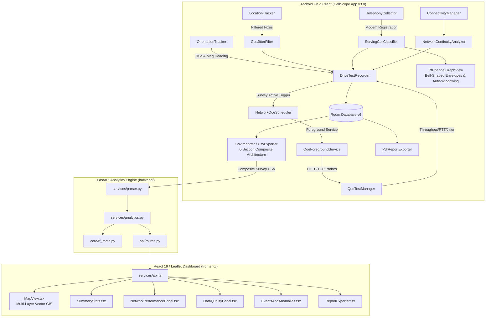

# CellScope 5G — Cellular Field Analytics, Autonomous QoE & Coverage Intelligence (v3.0 Production)

[](LICENSE)
[](#platform-architecture)
[](#what-is-new-in-version-30)
[](CellScope-v3.0.apk)
[](CellScope-v2.0-final.apk)
[](docs/CellScope_5G_v3_Technical_Report.pdf)

**CellScope 5G** is an enterprise-grade cellular field-testing, Radio Access Network (RAN) optimization, and multi-generation network intelligence platform engineered for telecommunications engineers, RF planning specialists, and field drive-test technicians. It seamlessly pairs a **native Kotlin Android field application** with an **asynchronous FastAPI post-processing microservice** and an **interactive Leaflet/MapLibre GIS web dashboard** for deep post-processing, mobility evaluation, and active Quality of Experience (QoE) auditing.

📄 **Publication Technical Report:** Read the complete 5-page publication-grade PDF report at [`docs/CellScope_5G_v3_Technical_Report.pdf`](docs/CellScope_5G_v3_Technical_Report.pdf).
📚 **Complete Documentation Suite:** See [Documentation Index](#documentation-index) below.

---

## Documentation Index

The CellScope-5G repository features complete, production-grade technical documentation across every subsystem:

| Document | Primary Focus & Contents |
| :--- | :--- |
| **[`docs/ARCHITECTURE.md`](docs/ARCHITECTURE.md)** | Multi-tier end-to-end architecture, Android-to-backend data pipeline, Room DB v6, and sequence diagrams. |
| **[`docs/MODELS_AND_ALGORITHMS.md`](docs/MODELS_AND_ALGORITHMS.md)** | Authoritative definitions of all 3GPP RF formulas, SINR provenance models, handover classifiers, and QoE algorithms. |
| **[`docs/API_DOCUMENTATION.md`](docs/API_DOCUMENTATION.md)** | OpenAPI REST API specification for FastAPI endpoints, schemas, parameters, and responses. |
| **[`docs/DATA_DICTIONARY.md`](docs/DATA_DICTIONARY.md)** | 6-Section Composite CSV specification, Room SQLite v6 tables, and cell identity composite keys. |
| **[`docs/DEVELOPER_AND_DEPLOYMENT_GUIDE.md`](docs/DEVELOPER_AND_DEPLOYMENT_GUIDE.md)** | Step-by-step workstation setup, APK assembly, FastAPI server execution, web dashboard build, and troubleshooting. |
| **[`CHANGELOG.md`](CHANGELOG.md)** | Detailed chronological release history, bug fixes, and platform upgrades. |
| **[`android/README.md`](android/README.md)** | Dedicated Android application guide: TelephonyManager, Room DB, Foreground Services, and MapLibre. |
| **[`backend/README.md`](backend/README.md)** | Dedicated FastAPI analytics microservice guide: 6-section CSV parser, RF math engine, and Pytest. |
| **[`frontend/README.md`](frontend/README.md)** | Dedicated Web GIS Dashboard guide: Leaflet multi-layer map, dual light/dark themes, and telecom filter drawer. |

---

## Latest Android APK — v3.0 Production

📦 **Download Latest Release:** [`CellScope-v3.0.apk`](CellScope-v3.0.apk) (~50.01 MB / `52,316,574 bytes`, verified build)

* **Version:** `v3.0.0-production` (Build 2026.10, API 26–35)
* **Build Variant:** Debug (`assembleDebug`) — signed with the standard Android debug keystore for seamless installation on test devices and developer handsets without requiring custom release key provisioning.
* **Core v3.0 Production Capabilities:**
  * **Automated Survey QoE Engine:** Automatically triggers active HTTP download/upload throughput, RTT latency, RFC 3550 jitter, and probe loss tests on survey start; configurable 5m/10m intervals with Foreground Service persistence.
  * **Restored RF Frequency Graph:** Smooth cubic Bézier bell-shaped channel envelopes with multi-band smart auto-windowing, fixed telecom dynamic bounds (-140 to -40 dBm), 16dp minimum visual half-width, and touch hit-testing.
  * **6-Section Multi-CSV Engine:** Resilient multi-section survey parser and exporter (`[SURVEY_METADATA]`, `[TELEMETRY_SAMPLES]`, `[ACTIVE_QOE_TESTS]`, `[MOBILITY_EVENTS]`, `[SERVICE_HOLES]`, `[ESTIMATED_TOWERS]`).
  * **SINR Provenance Resolution:** Strict discrimination between modem `MEASURED`, 3GPP TS 36.214 `ESTIMATED`, and `UNAVAILABLE` observations, with stateful rejection of uninitialized zero sentinels.
  * **Normalized Mobility Classification:** Strict event cards reflecting `CONFIRMED HANDOVER`, `INTRA-FREQUENCY TRANSITION`, `INTER-FREQUENCY TRANSITION`, `INTER-RAT TRANSITION`, `CELL RESELECTION`, `PING-PONG CANDIDATE`, `SIGNAL LOSS`, and `OBSERVED CELL CHANGE`.
  * **3GPP TS 45.005 GSM ARFCN Classification:** Precise discrimination of P-GSM 900, E-GSM 900, GSM 850, and DCS 1800.
  * **LTE CRS Modulo-3 & Reuse Analytics:** Hexagonal reuse distance ($D = R\sqrt{3N}$) and CRS subcarrier collision analysis ($v_{\text{shift}} = N_{\text{ID}}^{\text{cell}} \bmod 3$).

### Android Installation Instructions
1. Download [`CellScope-v3.0.apk`](CellScope-v3.0.apk) directly to your Android device (or install via ADB: `adb install -r CellScope-v3.0.apk`).
2. Open your device's **Files** or **Downloads** app and tap `CellScope-v3.0.apk`.
3. If prompted by Android system security, enable **"Install unknown apps"** / **"Allow from this source"**.
4. Tap **Install** (or **Update** if updating from a prior installation).
5. Grant the requested runtime permissions on initial launch:
   - **Location (Allow all the time / While in use):** Required for GNSS drive-test route tracking.
   - **Phone / Read Phone State:** Required for raw physical-layer telephony signal metrics and carrier frequency resolution.
   - **Notifications:** Required for the ongoing survey & QoE background Foreground Service.

---

## What is New in Version 3.0 (Major Release)

### 1. Rigorous SINR Provenance Resolution & Zero Sentinel Rejection (BUG 1 Fix)
* **Android RIL Sentinel Rejection:** Rejects modem uninitialized zero sentinels (`rawRssnr == 0`) unless genuine non-zero readings have been observed in the session. Uninitialized readings fall through to 3GPP TS 36.214 calibrated estimates or `UNAVAILABLE`.
* **Zero Co-Channel Interference Misdiagnosis:** Capacity recommendation engine no longer treats missing SINR as `0.0 dB`, eliminating false co-channel interference and cell-edge recommendations.
* **Map & Table Differentiation:** Web dashboard renders solid circle borders for modem `MEASURED` observations and dashed borders (`dashArray: '3, 3'`) for `3GPP ESTIMATED` observations.

### 2. Normalized Mobility Event Classification & Handover Cards (BUG 2 Fix)
* **Removed Passive Triggers:** Eliminated faulty logic that asserted confirmed handovers solely because vehicle speed exceeded $5\text{ km/h}$ with an active data connection or crossing a TAC boundary.
* **Normalized Event Cards:** Android event cards, timeline views, and web dashboard tables strictly display normalized badges (`CONFIRMED HANDOVER`, `INTRA-FREQUENCY TRANSITION`, `INTER-FREQUENCY TRANSITION`, `INTER-RAT TRANSITION`, `CELL RESELECTION`, `PING-PONG CANDIDATE`, `SIGNAL LOSS`, `OBSERVED CELL CHANGE`).

### 3. Automated Active Network QoE Testing with Survey Recording
* **Zero-Touch Background Loop:** Starting a survey recording automatically triggers an initial bounded QoE test and schedules ongoing 5m/10m testing loops.
* **Foreground Service Persistence:** Managed via `QoeForegroundService` with ongoing notification to prevent Doze-mode termination while the screen is off.
* **Removal of Hardcoded Caps:** User-configurable per-test limits, cumulative data caps, and safe cellular roaming safeguards.

### 4. Restored Bell-Shaped RF Channel Frequency Graph
* **Smooth Bell-Shaped Envelopes:** Renders continuous cubic Bézier channel curves for serving and neighbor cells, derived from 3GPP nominal bandwidth allocations and center frequencies.
* **Multi-Band Smart Auto-Focus Windowing:** Automatically windows onto the active serving cell's band when observed cells span multiple distant bands (> 60 MHz), preventing horizontal distortion. Horizontal filter chips (`All`, `B1`, `B3`, `B8`, `B28`, `B40`) allow instant manual band switching.
* **Touch Hit-Testing & Inspection:** Tapping any envelope displays an amber glowing peak ring, vertical leader line, and callout pill, while updating the *Cell Carrier Inspection* card with duplex separation, bandwidth, and signal quality metrics.

### 5. Multi-Section Schema-Aware CSV Engine & Audit Fixtures
* **6-Section Composite CSV:** Independently parses and validates `[SURVEY_METADATA]`, `[TELEMETRY_SAMPLES]`, `[ACTIVE_QOE_TESTS]`, `[MOBILITY_EVENTS]`, `[SERVICE_HOLES]`, and `[ESTIMATED_TOWERS]`.
* **Resilient Importer:** Validates each section against its own schema, reporting malformed rows without discarding valid telemetry samples.

### 6. Laptop Web Dashboard v3.0 Feature Parity & Multi-Layer GIS Synchronization
* **Refactored Header & Responsive Navigation:** Responsive max-width layout (`max-w-[1720px]`) and adaptive navigation tabs with dual short/full label breakpoints, eliminating tab clipping and scrollbars.
* **Multi-Layer Map Overlay Engine:** Leaflet GIS integration with dedicated layer groups for Metric Points, Survey Route Track, Weak Coverage Corridors, Handover Transition Badges, Estimated Cell Sites, and Timing Advance Range.
* **Slide-over Telecom Filter Drawer:** Comprehensive multi-parameter filtering by Serving PCI, RAT Generation, Operator, EARFCN, Signal Quality, Handover-only, and Weak-zone-only toggles. Filter selections dynamically recompute map layers, session KPIs, distributions, and data tables.

### 7. Global Light & Dark Theme Support (Web Dashboard)
* **Application-Wide Dual Theme:** Polished theme toggle supporting dark mode and high-contrast telecom light mode (`#F5F7FB` background, crisp white cards, `#0F172A` text).
* **Zero-Flash Client Persistence:** Pre-render inline anti-flash script in `index.html` backed by `localStorage` (`'cellscope-theme'`).
* **Map & Layer Synchronization:** Dynamic Leaflet raster tile filter toggle (`cellscope-dark-tiles` inverted tiles vs. `cellscope-light-tiles` clean OpenStreetMap basemap).

### 8. Radio Propagation & Mobility Analytics Suite (Web Dashboard)
* **Dedicated Analytical Navigation Tab:** Integrated `Radio Propagation & Mobility` module featuring four specialized physical layer and mobility sub-modules:
  * **Shadowing Analysis:** Evaluates macroscopic slow fading over distance via spatial moving averages, empirical linear path loss, residual standard deviation ($\sigma_\psi$), and candidate localized obstruction corridors on an interactive Leaflet map.
  * **Signal Fluctuation Analysis:** Tracks sample-to-sample deltas ($\Delta\text{dB}$), rolling standard deviation ($\sigma$), empirical signal distributions, and includes an active **sampling rate validation audit** disclosing the physical boundary between ~1 Hz macroscopic sampling and sub-wavelength fast fading.
  * **Multipath Propagation Analysis:** Computes spatial rate of change ($|\Delta\text{RSRP}| / \Delta d$ in dB/meter), highlights high spatial gradients, and detects repeated location clusters ($\le 20\text{m}$ radius across time) to evaluate scattering repeatability.
  * **Ping-Pong Handover Oscillation Analysis:** Detects $A \rightarrow B \rightarrow A$ mobility loops across configurable time windows ($\le 5\text{s}, 10\text{s}, 15\text{s}, 30\text{s}, 60\text{s}$), calculates intermediate cell dwell times, and strictly differentiates confirmed network handovers from periodic snapshot oscillations.
* **4-Subheading Scientific Explanations:** Every primary chart features dynamic explanations answering: *What the graph shows*, *Telecom interpretation*, *Why it matters*, and *Limitations and confidence*.

---

## Mathematical Formulations

See [`docs/MODELS_AND_ALGORITHMS.md`](docs/MODELS_AND_ALGORITHMS.md) for full mathematical derivations.

### 1. LTE Reference Signal Metrics
$$\text{RSRQ} = \frac{N \cdot \text{RSRP}}{\text{RSSI}} \implies \text{RSRQ}_{\text{dB}} = 10\log_{10}(N) + \text{RSRP}_{\text{dBm}} - \text{RSSI}_{\text{dBm}}$$
where $N$ is the number of downlink Resource Blocks across the carrier channel bandwidth.

### 2. 3GPP TS 36.214 LTE SINR Estimation Load Model
$$\text{offset} = 2.0 + 10.0 \cdot \eta \quad (\eta = 0.5 \implies \text{offset} = 7.0)$$
$$\text{denom} = \left(\frac{1}{\text{RSRQ}_{\text{linear}}}\right) - \text{offset}$$
$$\text{SINR}_{\text{dB}} = 10 \log_{10}\left(\frac{12.0}{\max(\text{denom}, 0.001)}\right)$$

### 3. LTE CRS Modulo-3 Subcarrier Shift
$$v_{\text{shift}} = N_{\text{ID}}^{\text{cell}} \bmod 3 = (3 \cdot N_{\text{ID}}^{(1)} + N_{\text{ID}}^{(2)}) \bmod 3 = N_{\text{ID}}^{(2)} \in \{0, 1, 2\}$$

### 4. Hexagonal Co-Channel Reuse Distance & Radius
$$D = R \cdot \sqrt{3N}, \quad Q = \frac{D}{R} = \sqrt{3N}$$
where empirical radius $R$ is calculated via Haversine great-circle distance:
$$\mathcal{H}(\phi_1, \lambda_1, \phi_2, \lambda_2) = 2R_{\text{Earth}} \arcsin \sqrt{\sin^2\left(\frac{\Delta\phi}{2}\right) + \cos\phi_1\cos\phi_2\sin^2\left(\frac{\Delta\lambda}{2}\right)}$$

### 5. 3GPP Downlink Carrier Frequency Raster
* **LTE (3GPP TS 36.101):** $F_{\text{DL}} = F_{\text{DL\_low}} + 0.1 \cdot (N_{\text{DL}} - N_{\text{Offs\_DL}})\text{ MHz}$
* **5G NR (3GPP TS 38.101-1):** $F_{\text{REF}} = 0.005 \cdot N_{\text{REF}}\text{ MHz}$ (sub-3 GHz) / $3000 + 0.015 \cdot (N_{\text{REF}} - 600000)\text{ MHz}$ (3–24 GHz)
* **GSM (3GPP TS 45.005):** P-GSM 900 ($935.0 + 0.2 \cdot n$), E-GSM 900 ($925.0 + 0.2 \cdot (n - 1024)$), DCS 1800 ($1805.2 + 0.2 \cdot (n - 512)$)

---

## System Architecture



---

## Technical Stack

| Component | Technology Stack |
| :--- | :--- |
| **Android OS & SDK** | Android 8.0+ (API 26 to 35), Native Kotlin 2.0 |
| **Android Architecture** | Clean Architecture / MVVM with StateFlow, Coroutines, Foreground Services |
| **Database** | Android Room Database v6 (KSP) with non-destructive migrations |
| **Map Rendering** | MapLibre Native Android SDK (11.5.1) with keyless OpenStreetMap tiles |
| **RF Visualization** | Custom `RfChannelGraphView` with cubic Bézier bell envelopes & touch hit-testing |
| **Document Generation**| Android `PdfDocument` paginated canvas engine & Python ReportLab A4 generator |
| **Backend API** | Python 3.11+, FastAPI 0.136, Pydantic v2, AnyIO, Uvicorn, Pytest |
| **Frontend Web** | React 19, Vite 8, TypeScript, Tailwind CSS v4, Leaflet 1.9, Lucide Icons, Chart.js |

---

## Verification & Test Results

All verification test suites have been executed and verified in place:

* **Android Unit Tests:** **272 / 272 Passed** (100% success rate across 52 test suites via `.\android\gradlew.bat testDebugUnitTest` in 19s, 0 failures, Exit Code 0).
* **Android Debug APK Assembly:** **BUILD SUCCESSFUL** via `assembleDebug` (`app-debug.apk` ~50.01 MB / `52,316,574 bytes`, Exit Code 0).
* **FastAPI Backend Analytics:** **43 / 43 Passed** (`python -m pytest backend/tests`, 0 failures, Exit Code 0).
* **Frontend Production Build:** **BUILD SUCCESSFUL** (`cmd /c "npm --prefix frontend run build"`, 1,937 modules transformed in 771ms, 0 errors, Exit Code 0).
* **Frontend Static Code Quality:** **0 Warnings, 0 Errors** (`npm run lint` via oxlint across 20 files, Exit Code 0).
* **End-to-End CSV Regression:** **100% Passed** (`MultiSectionCsvRegressionTest` validating 6-section survey dataset).

---

## Getting Started

See [`docs/DEVELOPER_AND_DEPLOYMENT_GUIDE.md`](docs/DEVELOPER_AND_DEPLOYMENT_GUIDE.md) for complete workstation setup and troubleshooting instructions.

### 1. Direct Android Installation
Transfer [`CellScope-v3.0.apk`](CellScope-v3.0.apk) to an Android device (API 26+) or install via ADB:
```bash
adb install -r CellScope-v3.0.apk
```

### 2. Building from Source
```powershell
# Set JDK 21+ environment (e.g. Android Studio JBR)
$env:JAVA_HOME = "C:\Program Files\Android\Android Studio\jbr"

# Run Android unit tests (272 tests)
cd android
.\gradlew.bat testDebugUnitTest

# Assemble Debug APK
.\gradlew.bat assembleDebug
```
The output APK is generated at `android/app/build/outputs/apk/debug/app-debug.apk` and copied to `CellScope-v3.0.apk`.

### 3. Running Backend Analytics Tests & Dev Server
```powershell
# Run backend pytest suite (43 tests)
$env:PYTHONPATH = "."
pytest backend/tests

# Start FastAPI development server
uvicorn backend.app.main:app --host 0.0.0.0 --port 8000 --reload
```

### 4. Running Web GIS Frontend
```bash
cd frontend
npm install
npm run dev

# To build for production:
npm run build
```

---

## License & Credits

This project is licensed under the [MIT License](LICENSE).
**Owner & Lead Engineer:** Sarkar Tuhassinul Arnob ([arnob.ict.iu@gmail.com](mailto:arnob.ict.iu@gmail.com))
**GitHub Repository:** [github.com/TuhassinulArnob/cellCoverageApp](https://github.com/TuhassinulArnob/cellCoverageApp)
**Academic Affiliation:** Department of Information and Communication Technology (ICT), Islamic University, Kushtia, Bangladesh.
