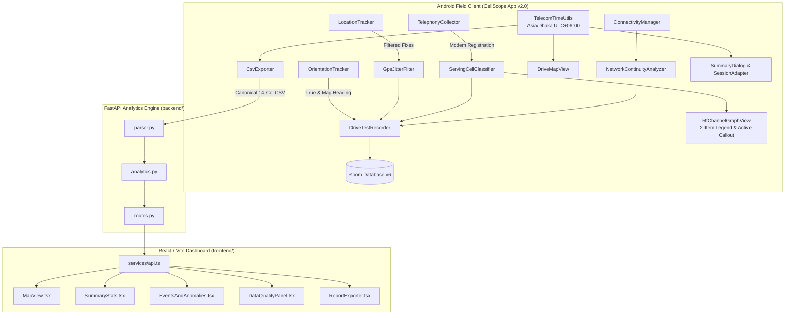

# CellScope — LTE & 5G Cellular Drive-Test Analytics & Coverage Intelligence (v2.0 Final)

[](LICENSE)
[](#platform-architecture)
[](#what-is-new-in-version-20)
[](CellScope-v2.0-final.apk)

**CellScope** is an enterprise-grade cellular field-testing, RF optimization, and multi-generation network intelligence platform engineered for Radio Access Network (RAN) engineers, RF planning specialists, and field drive-test technicians. It pairs a **native Kotlin Android field application** with an **interactive web analytics dashboard** for deep post-processing and drive-test evaluation.

📦 **Ready-to-install Android APK:** [`CellScope-v2.0-final.apk`](CellScope-v2.0-final.apk) (located directly in the repository root for immediate testing).

---

## What is New in Version 2.0 (Final Release)

### 1. Multi-Generation Network Continuity & Bearer Separation
* **Multi-RAT Logging:** Timestamped observation and classification of 2G GSM/EDGE, 3G UMTS/HSPA, 4G LTE, and 5G NR (NSA & SA).
* **Voice vs. Data Bearer Separation:** Independent tracking of voice network type (e.g. CSFB to 2G/3G or VoLTE) versus mobile data network type.
* **Continuity Analysis:** Automated detection and logging of generation changes, technology downgrades (e.g. 4G $\to$ 2G), recovery transitions, and outage dwell durations.

### 2. Service-Hole Detection & RF Diagnostics
* **7-Category Outage Diagnosis:** Root-cause evaluation of coverage dropouts including RF Edge, Terrain Shadowing, Downlink Power Depletion, Missing Handover Neighbor, Hardware Outage, and Sudden Signal Cliffs.
* **Telecom Anomaly Intelligence:** Ping-pong handover detection, pilot pollution identification ($\ge -95\text{ dBm}$ RSRP with $< 0\text{ dB}$ SINR or $< -14\text{ dB}$ RSRQ), and call-drop risk grading.
* **Weak Zone & Service-Hole Tracking:** Continuous segment identification for weak coverage ($< -105\text{ dBm}$) and complete radio loss ($< -115\text{ dBm}$).

### 3. Reliable GNSS Telemetry & Adaptive Jitter Suppression
* **Stationary Deadband Filter:** Multi-sample evidence-based jitter filtering prevents false speed and spurious distance accumulation while stationary indoors.
* **Outlier & Spike Gate:** Automatic rejection of coordinate jumps $> 50\text{ m/s}$, duplicate coordinates, stale fixes ($> 10\text{s}$ old), and poor-accuracy fixes.
* **Orientation & Heading Logging:** Fused Android rotation-vector, geomagnetic vector, and accelerometer-magnetometer fallback with `GeomagneticField` true north declination correction.

### 4. Authoritative Telecom Time Architecture (Asia/Dhaka BST)
* **Single Time Convention:** Internal storage preserved in UTC or epoch milliseconds; user-facing displays standardized in Bangladesh Standard Time (`Asia/Dhaka`, UTC+06:00).
* **Unambiguous CSV Serialization:** Timestamps in CSV exports are serialized with explicit ISO 8601 offset (`+06:00`), protected against double-conversion, and verified across midnight rollovers.
* **Monotonic Durations:** Recording elapsed duration is computed independently of timezones, preventing time-skew in survey duration calculations.

### 5. Simplified Cell Explorer RF Frequency Graph
* **Two-Item Authoritative Legend:** `Serving Cell` (Primary Blue `#0284C7`) and `Unconfirmed Neighbors` (Slate Gray `#64748B`).
* **Authoritative Serving Determination:** Strictly checks `cell.isServing && cell.isConfirmedServing` (never relying on PCI alone).
* **Clutter-Free Spectrum:** Eliminated persistent overlapping label piles. Peak dots for all cells, with a single active glowing callout tag only on the selected cell (`★ SERVING (PCI 288)` or `PCI 45 (Neighbor)`).
* **3GPP Standards Disclaimer:** Explicit note: *"3GPP Nominal Channel Allocation (RSRP Peak) • Not measured spectral power"*.

### 6. Critical Device Reliability & Crash Fixes
* **Redmi K50i Crash Resolution:** Eliminated the `android.view.InflateException: Error inflating class div` layout crash by safely retiring the experimental direction survey UI.
* **Non-Destructive Room Migration:** Retained Room database schema v6 integrity without dropping tables or breaking existing SQLite app data.
* **Screen Rotation Lifecycle:** Preserved ongoing foreground drive-test recordings and service bindings across device orientation changes.
* **Summary Dialog Main-Thread Dispatching:** Guaranteed that survey database finalization executes off the main thread while dialog UI displays safely on the Android main looper.

### 7. Unified Telecom Web Dashboard (`frontend/` & `backend/`)
* **Live Session KPIs:** Distance (Haversine), sample count, duration, GPS accuracy, and completeness percentage.
* **Multi-Layer Route Map:** Selectable 3GPP color-ramped layers for RSRP, RSRQ, and SINR with persistent top KPI banner and detailed serving-cell inspection card.
* **Data Quality Panel:** Audits missing values, telemetry gaps ($> 10\text{s}$), and measurement provenance.
* **Dual CSV & PDF Reports:** Canonical 14-column CSV contract preserved, extended 18-column CSV with multi-RAT metrics, and printable survey summary card.

---

## System Architecture



---

## Technical Stack

| Component | Technology Stack |
| :--- | :--- |
| **Android OS** | Android 8.0+ (API 26 to 36), Native Kotlin |
| **Android Architecture** | Clean Architecture / MVVM with StateFlow, Coroutines, Foreground Service |
| **Database** | Android Room Database v6 (KSP) with non-destructive migrations |
| **Map Rendering** | MapLibre Native Android SDK (11.5.1) with keyless OpenStreetMap tiles |
| **Time & Calendar** | Java 8+ `java.time.*` (ZonedDateTime, Instant, Asia/Dhaka) |
| **Document Generation**| Android `PdfDocument` paginated canvas engine & SAF |
| **Backend API** | Python 3.10+, FastAPI, Pydantic, Uvicorn, Pytest |
| **Frontend Web** | React 19, Vite, TypeScript, Tailwind CSS, Leaflet, Lucide Icons |

---

## Verification & Test Results

- **Android Unit Tests:** **151/151 Passed** (`.\gradlew.bat testDebugUnitTest` in 33s, 0 failures).
- **Android APK Assembly:** **BUILD SUCCESSFUL** (`CellScope-v2.0-final.apk`, ~48.3 MB).
- **Backend Analytics Engine:** **18/18 Passed** (`python -m pytest backend/tests -v` in 3.21s).
- **Frontend Dashboard Build:** **Build Succeeded** (`npm.cmd run build`, 1932 modules transformed in 1.32s).

---

## Getting Started

### 1. Direct Android Installation
Transfer [`CellScope-v2.0-final.apk`](CellScope-v2.0-final.apk) to an Android device (API 26+) and install directly.

### 2. Building from Source
```bash
# Android App Build
cd android
./gradlew.bat testDebugUnitTest
./gradlew.bat assembleDebug

# Python Backend
python -m pytest backend/tests/ -v
python backend/run.py

# Frontend Development
cd frontend
npm install
npm run dev
```

---

## License & Credits

This project is licensed under the [MIT License](LICENSE).  
**Owner & Lead Engineer:** Sarkar Tuhassinul Arnob ([arnob.ict.iu@gmail.com](mailto:arnob.ict.iu@gmail.com))  
**GitHub:** [github.com/TuhassinulArnob](https://github.com/TuhassinulArnob) | **LinkedIn:** [linkedin.com/in/tuhassinularnob](https://www.linkedin.com/in/tuhassinularnob/?isSelfProfile=true)
