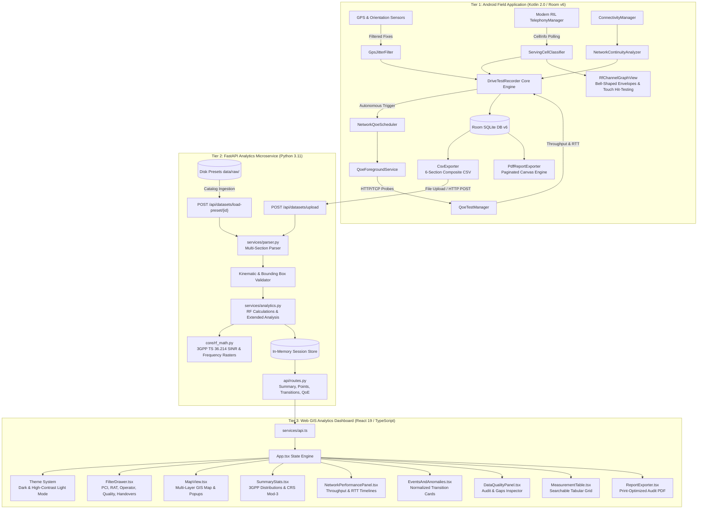
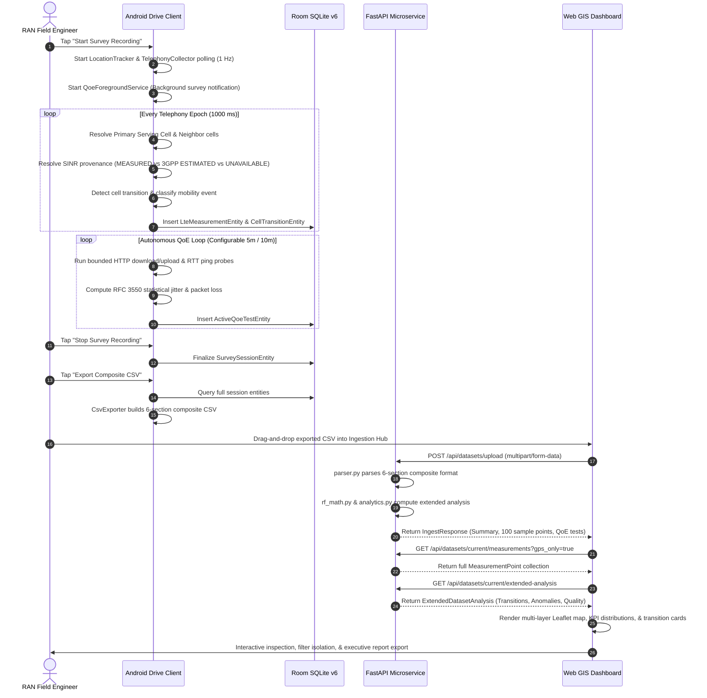

# CellScope-5G: End-to-End System Architecture Specification

**Document Version:** 3.0.0 (Production)
**Status:** Approved & Verified
**Author:** Sarkar Tuhassinul Arnob (Lead System Architect)

---

## 1. Executive Architecture Summary

CellScope-5G is a multi-tier telecommunications RAN (Radio Access Network) drive-testing, physical-layer RF optimization, and active QoE intelligence platform. The system operates across three tightly integrated tiers:

1. **Mobile Field Capture Client (`android/`):**
   - Native Android application built in Kotlin 2.0 targeting API 26 to 35.
   - Leverages `TelephonyManager`, `TelephonyCallback` / `PhoneStateListener`, and `FusedLocationProviderClient`.
   - Runs background survey recording and autonomous QoE testing using Android Foreground Services.
   - Persists data locally in an ACID-compliant Room SQLite Database (Version 6).
   - Generates publication-grade on-device PDF reports and 6-section composite CSV survey logs.

2. **Analytical Post-Processing Microservice (`backend/`):**
   - High-throughput asynchronous REST microservice built with Python 3.11+ and FastAPI.
   - Multi-format ingestion engine parsing canonical single-table and 6-section composite CSVs.
   - Grounded mathematical engine executing 3GPP TS 36.133, TS 36.214, TS 38.101, and TS 45.005 RF formulas.
   - Kinematic trajectory validator with spatial bounding box and GPS jitter rejection.
   - Analytical synthesizer generating mobility transitions, RF anomalies, and coverage hole segments.

3. **Interactive Web GIS & Engineering Dashboard (`frontend/`):**
   - Single-Page Application (SPA) built with React 19, TypeScript, and Vite 8.
   - Leaflet / MapLibre multi-layer vector map with dynamic tile styling (Dark & Light modes).
   - Real-time slide-over telecom filter drawer with instant multi-parameter re-aggregation.
   - 3GPP carrier & band inventory, LTE CRS modulo-3 collision analysis, and active QoE performance metrics.

---

## 2. Platform Architecture Diagram

---

## 3. End-to-End Data Flow Sequence

---

## 4. Subsystem Details & Component Responsibilities

### 4.1 Android Client Subsystems
* **`telephony/`**:
  * `TelephonyCollector.kt`: Collects registered and neighbor cell information via `TelephonyManager`.
  * `ServingCellClassifier.kt`: Identifies primary serving cell using RIL registration flags and power hierarchy.
  * `SinrDiagnostics.kt`: Standardizes SINR provenance (`MEASURED`, `ESTIMATED`, `UNAVAILABLE`) and rejects uninitialized zero sentinels.
  * `LteBandTable.kt`: Maps EARFCN to 3GPP operating bands, duplex mode, and operator allocations.
  * `OperatorIdentity.kt`: Maps MCC/MNC to Bangladesh operators (Grameenphone, Robi, Banglalink, Teletalk).
* **`recorder/`**:
  * `DriveTestRecorder.kt`: Central coordinator managing survey session lifecycle, sample throttling, and Room insertion.
  * `GpsJitterFilter.kt`: Rejects GPS multipath teleportation jumps and computes kinematic speed.
* **`qoe/`**:
  * `QoeTestManager.kt`: Executes bounded chunked HTTP throughput and ICMP/TCP ping latency tests.
  * `NetworkQoeScheduler.kt`: Manages recurring scheduled testing loops.
  * `QoeForegroundService.kt`: Keeps the survey loop active during screen-off and Doze mode.
* **`ui/`**:
  * `RfChannelGraphView.kt`: Custom canvas drawing cubic Bézier bell-shaped channel envelopes with dynamic bounds and smart auto-windowing.
  * `MobilityTimelineView.kt`: Multi-lane mobility timeline separating confirmed handovers, intra-freq, inter-freq, and inter-RAT events.
  * `TransitionAdapter.kt`: Formats normalized transition cards underneath the timeline.

### 4.2 Backend Microservice Subsystems
* **`parser.py`**: Multi-section aware parser with regex header normalization and graceful recovery from malformed lines.
* **`rf_math.py`**: Mathematical implementation of 3GPP TS 36.133, TS 36.214, TS 38.101, and TS 45.005.
* **`analytics.py`**: Statistical aggregation, spatial bounding box calculation, cell transition detection, and anomaly classification.
* **`routes.py`**: REST endpoint router handling session caching, upload, filtering, and export.

### 4.3 Frontend Web Subsystems
* **`MapView.tsx`**: Interactive Leaflet GIS map with color-coded metric layers, route tracking, tower centroids, and transition diamonds.
* **`SummaryStats.tsx`**: Executive KPI cards, 3GPP distributions, carrier inventory, and CRS mod-3 collisions.
* **`EventsAndAnomalies.tsx`**: Table of normalized cell transitions, pilot pollution alerts, and weak coverage zones.
* **`NetworkPerformancePanel.tsx`**: Throughput and latency charts with active QoE test record logs.
* **`FilterDrawer.tsx`**: Slide-over multi-parameter telecom filter drawer with instant cross-component updates.

---

## 5. Security, Permissions & Data Privacy

1. **Android Runtime Permissions:**
   - `ACCESS_FINE_LOCATION` & `ACCESS_BACKGROUND_LOCATION`: Required for geographic mapping.
   - `READ_PHONE_STATE`: Required for telephony cell identity and signal strength.
   - `POST_NOTIFICATIONS`: Required for Android 13+ foreground survey notifications.
2. **Local Processing & Zero Data Exfiltration:**
   - All drive-test telemetry is stored strictly on the local device or inside the self-hosted Python backend.
   - No user credentials, location telemetry, or identity metrics are sent to third-party cloud services.
3. **No Root Requirement:**
   - Operates entirely on standard unrooted consumer and engineering devices via public Android SDK APIs.
