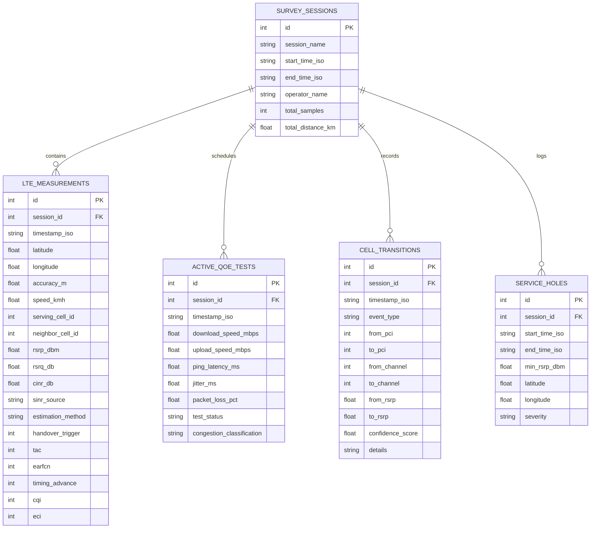

# CellScope-5G: Data Dictionary & Storage Schema Specification

**Document Version:** 3.0.0
**Database Version:** Android Room v6 (SQLite)
**CSV Architecture:** 6-Section Composite Modular Survey Format
**Author:** Sarkar Tuhassinul Arnob (RAN & Lead Engineer)

---

## 1. Overview

CellScope-5G maintains complete schema synchronization across:
1. **Android Room SQLite Database (Version 6):** Embedded, transactional storage on the mobile client.
2. **6-Section Modular Survey CSV:** Plaintext field survey exchange format supporting single-table legacy logs and multi-section composite logs.
3. **FastAPI Pydantic v2 Models:** Server-side validation and analytical transformation layer.
4. **React / TypeScript Interfaces:** Client-side GIS visualization and table manipulation schemas.

---

## 2. 6-Section Composite Survey CSV Specification

The CellScope-5G modular CSV format separates heterogenous drive-test telemetry streams using explicit bracketed headers. Comments begin with `#`.

```
┌────────────────────────────────────────────────────────────────────────┐
│             CellScope 6-Section Multi-CSV Architecture                 │
├────────────────────────────────────────────────────────────────────────┤
│ Section 1: # [SURVEY_METADATA]                                         │
│            Survey ID, Device Model, Android OS, Operator, Start Time   │
├────────────────────────────────────────────────────────────────────────┤
│ Section 2: # [TELEMETRY_SAMPLES] (Primary Radio Observations)          │
│            Timestamp, Lat, Lon, Speed, PCI, RSRP, RSRQ, CINR, Provenance│
├────────────────────────────────────────────────────────────────────────┤
│ Section 3: # [ACTIVE_QOE_TESTS] (Bounded Throughput & Latency Probes)  │
│            Test ID, Timestamp, Download Mbps, Upload Mbps, Ping, Jitter │
├────────────────────────────────────────────────────────────────────────┤
│ Section 4: # [MOBILITY_EVENTS] (Cell Transitions & Handovers)          │
│            Event ID, Timestamp, Type, From PCI, To PCI, Confidence     │
├────────────────────────────────────────────────────────────────────────┤
│ Section 5: # [SERVICE_HOLES] (Coverage Blackspots & Outages)           │
│            Hole ID, Start Time, End Time, Min RSRP, Location, Severity │
├────────────────────────────────────────────────────────────────────────┤
│ Section 6: # [ESTIMATED_TOWERS] (Power-Weighted Centroid Cell Sites)   │
│            PCI, EARFCN, Estimated Lat, Estimated Lon, Uncertainty (m)  │
└────────────────────────────────────────────────────────────────────────┘
```

---

### Section 2 Column Schema: `[TELEMETRY_SAMPLES]`

| Index | Column Name | Type | Unit | Nullable | Description & Engineering Standards |
| :---: | :--- | :---: | :---: | :---: | :--- |
| 1 | `Timestamp` | String | ISO 8601 | No | Handset sample timestamp (`YYYY-MM-DDTHH:mm:ss.sssZ`). |
| 2 | `Latitude` | Float | Deg | Yes | WGS84 geographic latitude ($-90.0$ to $+90.0$). |
| 3 | `Longitude` | Float | Deg | Yes | WGS84 geographic longitude ($-180.0$ to $+180.0$). |
| 4 | `Accuracy (m)` | Float | Meters | Yes | GNSS horizontal estimated accuracy radius (68% confidence). |
| 5 | `Heading (deg)` | Float | Deg | Yes | Ground track heading azimuth ($0.0^\circ$ to $360.0^\circ$). |
| 6 | `Altitude (m)` | Float | Meters | Yes | Altitude above WGS84 reference geoid. |
| 7 | `Speed (km/h)` | Float | km/h | Yes | Ground vehicle kinematic speed over ground. |
| 8 | `Serving Cell ID` | Integer | ID | Yes | Physical Cell Identity ($\text{PCI} \in [0, 503]$ for LTE, $[0, 1007]$ for 5G NR). |
| 9 | `Neighbor Cell ID` | Integer | ID | Yes | Strongest observed non-serving neighbor PCI. |
| 10 | `Serving Cell RSRP` | Float | dBm | Yes | Physical Reference Signal Received Power ($-140.0$ to $-40.0\text{ dBm}$). |
| 11 | `Serving Cell RSRQ` | Float | dB | Yes | Physical Reference Signal Received Quality ($-25.0$ to $-3.0\text{ dB}$). |
| 12 | `Serving Cell CINR` | Float | dB | Yes | Carrier to Interference plus Noise Ratio ($-25.0$ to $+35.0\text{ dB}$). |
| 13 | `SINR Source` | String | Enum | No | Provenance: `MEASURED`, `ESTIMATED`, or `UNAVAILABLE`. |
| 14 | `Estimation Method`| String | Text | Yes | Method: `3GPP_TS_36_214_RSRQ_LOAD_MODEL` or modem driver. |
| 15 | `Handover Trigger` | Integer | Binary | No | `1` if Layer-3 handover trigger was asserted; else `0`. |
| 16 | `TAC` | Integer | Code | Yes | Tracking Area Code ($0$ to $65535$). |
| 17 | `EARFCN` | Integer | Channel | Yes | E-UTRA Absolute Radio Frequency Channel Number ($0$ to $262143$). |
| 18 | `RSSI (dBm)` | Float | dBm | Yes | Wideband Carrier Received Signal Strength Indicator. |
| 19 | `Timing Advance` | Integer | Steps | Yes | LTE TA value ($0 \le T_A \le 1282$, step $\approx 78.12\text{ m}$). |
| 20 | `CQI` | Integer | Index | Yes | Channel Quality Indicator ($1$ to $15$). |
| 21 | `ECI` | Integer | ID | Yes | E-UTRAN Cell Identifier ($28\text{-bit}$ integer). |
| 22 | `Network Type` | String | Text | Yes | Radio technology string (e.g. `LTE`, `NR`, `GSM`). |
| 23 | `Network Gen` | String | Text | Yes | Normalized generation: `4G LTE`, `5G NR`, `2G GSM`. |
| 24 | `Operator` | String | Text | Yes | Commercial carrier name (e.g. `Robi Axiata`, `Grameenphone`). |

---

### Section 3 Column Schema: `[ACTIVE_QOE_TESTS]`

| Index | Column Name | Type | Unit | Nullable | Description |
| :---: | :--- | :---: | :---: | :---: | :--- |
| 1 | `Test_ID` | Integer | Integer | No | Monotonic test execution identifier. |
| 2 | `Session_ID` | Integer | Integer | Yes | Foreign key to `survey_sessions` table. |
| 3 | `Timestamp` | String | ISO 8601 | No | Test start timestamp. |
| 4 | `Timestamp_Ms` | Long | Unix ms | No | Epoch timestamp in milliseconds. |
| 5 | `Test_Type` | String | Text | No | `AUTOMATIC_SCHEDULED` or `MANUAL_PROMPT`. |
| 6 | `Test_Status` | String | Text | No | `SUCCESS`, `FAILED`, or `SKIPPED`. |
| 7 | `Skipped_Reason` | String | Text | Yes | Reason if test was skipped (e.g., roaming, data cap). |
| 8 | `Latitude` | Float | Deg | Yes | GPS latitude fix during test initiation. |
| 9 | `Longitude` | Float | Deg | Yes | GPS longitude fix during test initiation. |
| 10 | `Accuracy_m` | Float | Meters | Yes | GNSS accuracy radius. |
| 11 | `Has_Valid_GPS` | Integer | Binary | No | `1` for valid coordinates; `0` for no fix. |
| 12 | `Serving_RAT` | String | Text | Yes | Serving radio access technology. |
| 13 | `Serving_PCI` | Integer | ID | Yes | Serving PCI during the test. |
| 14 | `Serving_Channel` | Integer | Channel | Yes | Serving channel frequency (EARFCN). |
| 15 | `Serving_RSRP` | Float | dBm | Yes | Serving RSRP at test time. |
| 16 | `Serving_RSRQ` | Float | dB | Yes | Serving RSRQ at test time. |
| 17 | `Serving_SINR` | Float | dB | Yes | Serving SINR at test time. |
| 18 | `Operator` | String | Text | Yes | Network operator identity. |
| 19 | `Endpoint_URL` | String | URL | Yes | HTTP probe endpoint (e.g., Cloudflare Speed probe). |
| 20 | `Download_Mbps` | Float | Mbps | Yes | Bounded HTTP download throughput. |
| 21 | `Upload_Mbps` | Float | Mbps | Yes | Bounded HTTP upload throughput. |
| 22 | `Bytes_Downloaded`| Long | Bytes | Yes | Total bytes received during download phase. |
| 23 | `Bytes_Uploaded` | Long | Bytes | Yes | Total bytes transmitted during upload phase. |
| 24 | `Download_Duration_Ms` | Long | ms | Yes | Duration of download phase. |
| 25 | `Upload_Duration_Ms` | Long | ms | Yes | Duration of upload phase. |
| 26 | `Ping_Latency_Ms` | Float | ms | Yes | Median RTT latency over probe series. |
| 27 | `Min_Ping_Ms` | Float | ms | Yes | Minimum observed RTT probe. |
| 28 | `Max_Ping_Ms` | Float | ms | Yes | Maximum observed RTT probe. |
| 29 | `Jitter_Ms` | Float | ms | Yes | RFC 3550 statistical transit variance. |
| 30 | `Packet_Loss_Pct` | Float | % | Yes | Timed probe packet loss percentage. |
| 31 | `Congestion_Class` | String | Enum | Yes | `OPTIMAL`, `MODERATE_CONGESTION`, `HEAVY_CONGESTION`. |
| 32 | `Engine_Version` | String | Text | No | Test harness version identifier. |

---

### Section 4 Column Schema: `[MOBILITY_EVENTS]`

| Index | Column Name | Type | Description |
| :---: | :--- | :---: | :--- |
| 1 | `Event_ID` | Integer | Monotonic transition sequence number. |
| 2 | `Timestamp` | String | Transition event timestamp (ISO 8601). |
| 3 | `Event_Type` | String | `CONFIRMED_HANDOVER`, `INTRA_FREQ`, `INTER_FREQ`, `INTER_RAT`, `CELL_RESELECTION`, `PING_PONG`, `SIGNAL_LOSS`, `OBSERVED_CELL_CHANGE`. |
| 4 | `From_RAT` | String | Source Radio Access Technology. |
| 5 | `To_RAT` | String | Target Radio Access Technology. |
| 6 | `From_PCI` | Integer | Source Physical Cell ID. |
| 7 | `To_PCI` | Integer | Target Physical Cell ID. |
| 8 | `From_Channel` | Integer | Source carrier channel frequency (EARFCN/ARFCN). |
| 9 | `To_Channel` | Integer | Target carrier channel frequency (EARFCN/ARFCN). |
| 10 | `From_Cell_ID` | Integer | Source ECI/NCI. |
| 11 | `To_Cell_ID` | Integer | Target ECI/NCI. |
| 12 | `From_Signal_dBm` | Float | Source serving cell RSRP in dBm. |
| 13 | `To_Signal_dBm` | Float | Target serving cell RSRP in dBm. |
| 14 | `From_TAC` | Integer | Source Tracking Area Code. |
| 15 | `To_TAC` | Integer | Target Tracking Area Code. |
| 16 | `Confidence_Label`| String | `CONFIRMED`, `HIGH`, `MEDIUM`, `CONFIRMED_RAT`, `EMPIRICAL`. |
| 17 | `Confidence_Score`| Float | Confidence metric ($0.0$ to $1.0$). |
| 18 | `Details` | String | Human-readable engineering transition diagnosis. |

---

## 3. Android Room Database v6 Schema (SQLite)

The native Android application persists drive-test surveys using Android Room v6 (KSP).



---

## 4. Cell Identity & Composite Key Relationships

In cellular networks, a **Physical Cell ID (PCI)** is an integer in $[0, 503]$ (LTE) or $[0, 1007]$ (5G NR). Because there are only 504 PCI values in LTE, **PCIs are reused every few kilometers across a metropolitan network**.

* **PCI is NOT globally unique:** Never use PCI alone as a unique database primary key.
* **Globally Unique Cell Key:**
  $$\text{Global Cell Key} = \text{MCC} + \text{MNC} + \text{ECI} \quad (\text{or } \text{PLMN-ID} + \text{NCI} \text{ for 5G NR})$$
* **Drive-Test Cluster Composite Key:**
  $$\text{Cluster Key} = (\text{Operator}, \text{EARFCN}, \text{PCI}, \text{TAC})$$
