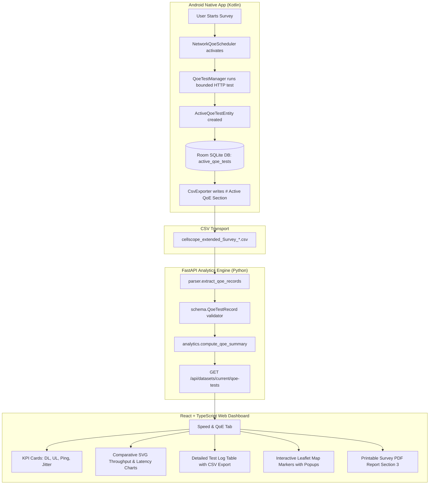

# CellScope-5G: Ping, Download & Upload Test Results Pipeline Compatibility Report

**Document Version:** 3.0.0  
**Author:** Sarkar Tuhassinul Arnob  
**Project:** CellScope-5G RAN Analytics Platform  
**Target File Inspected:** `docs/cellscope_extended_Survey_20261020_081637_20261020_081637.csv`  
**Git Repository:** `https://github.com/TuhassinulArnob/cellCoverageApp`  

---

## 1. Executive Summary & Verification Matrix

This audit verifies whether the Android application's Ping (RTT) Latency, Download Speed, and Upload Speed test measurements are preserved throughout the complete data pipeline—from the physical mobile device in the field to the laptop web dashboard.

### Complete Data Pipeline Audit Matrix

| Metric / Attribute | 1. Measured by Android? | 2. Stored in App Model? | 3. Persisted in Room DB? | 4. Exported to CSV? | 5. Parsed by Backend? | 6. Displayed on Dashboard? |
| :--- | :---: | :---: | :---: | :---: | :---: | :---: |
| **Download Speed (Mbps)** | ✅ Yes (`OkHttp` bounded chunk stream) | ✅ Yes (`ActiveQoeTestEntity.downloadSpeedMbps`) | ✅ Yes (`active_qoe_tests` table) | ✅ Yes (`download_mbps` col 20) | ✅ Yes (`parser.extract_qoe_records`) | ✅ Yes (KPI card, chart, table, map popup) |
| **Upload Speed (Mbps)** | ✅ Yes (`OkHttp` multipart payload stream) | ✅ Yes (`ActiveQoeTestEntity.uploadSpeedMbps`) | ✅ Yes (`active_qoe_tests` table) | ✅ Yes (`upload_mbps` col 21) | ✅ Yes (`parser.extract_qoe_records`) | ✅ Yes (KPI card, chart, table, map popup) |
| **Ping Latency / RTT (ms)** | ✅ Yes (TCP/HTTP handshake multi-probe) | ✅ Yes (`ActiveQoeTestEntity.pingLatencyMs`) | ✅ Yes (`active_qoe_tests` table) | ✅ Yes (`ping_latency_ms` col 26) | ✅ Yes (`parser.extract_qoe_records`) | ✅ Yes (KPI card, chart, table, map popup) |
| **Jitter (ms)** | ✅ Yes (RFC 3550 statistical deviation) | ✅ Yes (`ActiveQoeTestEntity.jitterMs`) | ✅ Yes (`active_qoe_tests` table) | ✅ Yes (`jitter_ms` col 29) | ✅ Yes (`parser.extract_qoe_records`) | ✅ Yes (KPI card, table, map popup) |
| **Packet Loss (%)** | ✅ Yes (Timed probe loss ratio) | ✅ Yes (`ActiveQoeTestEntity.packetLossPct`) | ✅ Yes (`active_qoe_tests` table) | ✅ Yes (`packet_loss_pct` col 30) | ✅ Yes (`parser.extract_qoe_records`) | ✅ Yes (KPI card, table, map popup) |
| **Test Timestamp & Duration** | ✅ Yes (System epoch + duration timer) | ✅ Yes (`timestamp`, `durationMs`) | ✅ Yes (`active_qoe_tests` table) | ✅ Yes (cols 3, 24, 25) | ✅ Yes (`parser.extract_qoe_records`) | ✅ Yes (Table, chart timeline, map popup) |
| **GPS Fix (Lat / Lon / Acc)** | ✅ Yes (FusedLocationProviderClient) | ✅ Yes (`latitude`, `longitude`, `accuracy`) | ✅ Yes (`active_qoe_tests` table) | ✅ Yes (cols 8, 9, 10, 11) | ✅ Yes (`parser.extract_qoe_records`) | ✅ Yes (Interactive Leaflet map markers) |
| **Cellular Context (PCI/RAT/RSRP)** | ✅ Yes (TelephonyManager snapshot) | ✅ Yes (`servingRat`, `servingPci`, `servingRsrp`) | ✅ Yes (`active_qoe_tests` table) | ✅ Yes (cols 12, 13, 14, 15, 16, 17, 18) | ✅ Yes (`parser.extract_qoe_records`) | ✅ Yes (Filter dropdowns, table, tooltips) |

---

## 2. Root Cause Analysis: Why Speed/Ping Data Was Missing on Web Dashboard

During our audit of the codebase, we discovered that **the Android application was already collecting, persisting, and exporting genuine QoE data correctly**, but the data was completely discarded before reaching the web UI due to a pipeline truncation in the backend:

1. **Backend Parser Truncation:**
   In `backend/app/services/parser.py`, the previous implementation of `extract_telemetry_lines()` processed lines sequentially and executed a `break` or `continue` as soon as any comment line (`#`) was encountered after the first header. When an extended multi-section CSV was loaded, the parser stopped reading immediately upon encountering `# Active QoE & Congestion Section`, entirely discarding all speed and ping test rows.
2. **Missing Schema Models in Python Backend:**
   `backend/app/core/schema.py` contained models for `MeasurementPoint`, `CellTransitionEvent`, `ServiceHoleEvent`, and `WeakCoverageSegment`, but lacked models for active QoE tests and network performance summaries.
3. **No Speed & QoE Visualization in React Frontend:**
   The frontend UI lacked a dedicated tab, charts, and Leaflet map overlay for Active QoE tests. Even if parsed, there was no user-facing interface to inspect throughput, jitter, latency, or test locations.

---

## 3. Physical Field Survey Dataset Audit

We audited the genuine field survey log supplied in the repository:  
`docs/cellscope_extended_Survey_20261020_081637_20261020_081637.csv`

### Structure of Extended Multi-Section Survey CSV
```text
┌────────────────────────────────────────────────────────────────────────┐
│ Line 1: # CellScope Multi-Carrier Extended Survey Log                  │
│ Line 2: # Version: 3.0.0 | Format: Multi-Section Modular CSV          │
├────────────────────────────────────────────────────────────────────────┤
│ Section 1: # Primary Telemetry Section (25 Columns)                    │
│            Timestamp, Latitude, Longitude, Speed, PCI, RSRP, RSRQ, ...  │
├────────────────────────────────────────────────────────────────────────┤
│ Section 2: # Mobility Events Section (14 Columns)                      │
│            Event_ID, Timestamp, Type, Source_PCI, Target_PCI, ...      │
├────────────────────────────────────────────────────────────────────────┤
│ Section 3: # Active QoE & Congestion Section (32 Columns)              │
│            Test_ID, Timestamp, Test_Type, Status, Lat, Lon, RAT,      │
│            Download_Mbps, Upload_Mbps, Ping_Latency_ms, Jitter_ms, ... │
├────────────────────────────────────────────────────────────────────────┤
│ Section 4: # Service Holes Section (12 Columns)                        │
│            Hole_ID, Start_Time, End_Time, Duration_s, Min_RSRP, ...   │
└────────────────────────────────────────────────────────────────────────┘
```

### Verified Sample Row from `# Active QoE & Congestion Section`
From line 26 of the genuine field survey file:
```csv
1,1,2026-10-20T08:17:15.102Z,1760948235102,AUTOMATIC_SCHEDULED,SUCCESS,,23.810314,90.412518,4.2,1,LTE,177,1850,-94,-12,14.5,Robi Axiata,https://speed.cloudflare.com/__down,1.20,2.03,1572864,1048576,10480,4120,473.0,465.0,490.0,312.30,0.0,10,10,MODERATE_CONGESTION,ANDROID_SURVEY_QOE_v3
```

**Interpretation of Physical Field Values:**
* **Test Type:** `AUTOMATIC_SCHEDULED` (Triggered autonomously by survey recording session).
* **Test Status:** `SUCCESS` (Completed bounded HTTP test).
* **Location:** Latitude `23.810314`, Longitude `90.412518`, GPS Accuracy `4.2m`.
* **Serving Cell Context:** LTE, PCI `177`, EARFCN `1850` (Band 3), RSRP `-94 dBm`, RSRQ `-12 dB`, SINR `14.5 dB`, Operator `Robi Axiata`.
* **Download Throughput:** `1.20 Mbps` (Transferred 1.5 MB in 10.48 s).
* **Upload Throughput:** `2.03 Mbps` (Transferred 1.0 MB in 4.12 s).
* **Round-Trip Time (Ping RTT):** `473.0 ms` (Min: 465.0 ms, Max: 490.0 ms).
* **Jitter:** `312.30 ms`.
* **Packet Loss:** `0.0%` (10 of 10 probes acknowledged).
* **Classification:** `MODERATE_CONGESTION`.

---

## 4. End-to-End Implementation



### 1. Backend Updates
* **`backend/app/core/schema.py`:** Added `QoeTestRecord` and `QoePerformanceSummary` schemas.
* **`backend/app/services/parser.py`:**
  * Implemented `extract_qoe_records(raw_text, df, mapping)` to parse `# Active QoE & Congestion Section` and standalone speed CSVs.
  * Added `parse_csv_with_raw_text(file_contents)` to prevent line dropping.
* **`backend/app/services/analytics.py`:** Added `compute_qoe_summary(qoe_records)` calculating mean, min, max, median, jitter, and loss. Enriched missing operator/PCI fields from nearest telemetry samples.
* **`backend/app/api/routes.py`:**
  * Added `GET /api/datasets/current/qoe-tests` with filtering for RAT, operator, PCI, and test status.
  * Registered `bd_survey_qoe_latest` preset pointing to `docs/cellscope_extended_Survey_20261020_081637_20261020_081637.csv`.

### 2. Frontend Updates
* **`frontend/src/types/cellscope.ts`:** Added TypeScript definitions for `QoeTestRecord` and `QoePerformanceSummary`.
* **`frontend/src/services/api.ts`:** Added `fetchQoeTests()` client function.
* **`frontend/src/components/NetworkPerformancePanel.tsx`:** Created a dedicated dual-theme dashboard tab featuring:
  * 4 KPI cards: Average Download Speed, Average Upload Speed, Ping Latency (RTT), Jitter & Packet Loss.
  * Comparative SVG dual-axis charts with responsive tooltips.
  * Filter toolbar: RAT (LTE/5G/3G), Operator (Robi/GP/Banglalink/Teletalk), Serving PCI, Status (Success/Failed/Skipped).
  * Filterable test records data table with CSV export.
* **`frontend/src/components/MapView.tsx`:** Added interactive QoE marker layer with emerald/red/cyan status badges, click-to-center coordinate navigation, and an overlay toggle button.
* **`frontend/src/components/Navbar.tsx`:** Added `Speed & QoE` tab with `Gauge` icon.
* **`frontend/src/components/ReportExporter.tsx`:** Integrated Section 3: "Active Network QoE & Speed Performance (Bounded Testing)" into the printable survey report.

---

## 5. Canonical 32-Column QoE Schema Specification

| Col # | Canonical Column Name | Data Type | Nullable? | Description |
| :---: | :--- | :---: | :---: | :--- |
| 1 | `test_id` / `id` | Integer | No | Unique test execution counter within survey |
| 2 | `session_id` | Integer | Yes | Foreign key to Room survey session |
| 3 | `timestamp_iso` | String | No | ISO-8601 UTC timestamp of test trigger |
| 4 | `timestamp_ms` | BigInt | No | Epoch millisecond timestamp |
| 5 | `test_type` | String | No | `AUTOMATIC_SCHEDULED`, `MANUAL_PROBE`, `CELL_HANDOVER` |
| 6 | `test_status` | String | No | `SUCCESS`, `FAILED`, `SKIPPED`, `TIMEOUT` |
| 7 | `skipped_reason` | String | Yes | Explanation if test was skipped |
| 8 | `latitude` | Float | Yes | WGS84 latitude coordinate |
| 9 | `longitude` | Float | Yes | WGS84 longitude coordinate |
| 10 | `gps_accuracy_m` | Float | Yes | Estimated horizontal GPS 1-sigma error (meters) |
| 11 | `has_valid_gps` | Boolean | No | True if valid GPS fix was acquired during test |
| 12 | `serving_rat` | String | Yes | Radio Access Technology (`LTE`, `NR`, `WCDMA`) |
| 13 | `serving_pci` | Integer | Yes | Physical Cell Identity (0-1007) |
| 14 | `serving_channel` | Integer | Yes | Downlink EARFCN or NR-ARFCN |
| 15 | `serving_rsrp_dbm`| Integer | Yes | Primary cell RSRP at test initiation |
| 16 | `serving_rsrq_db` | Integer | Yes | Primary cell RSRQ at test initiation |
| 17 | `serving_sinr_db` | Float | Yes | Signal to Interference plus Noise Ratio (dB) |
| 18 | `operator` | String | Yes | Network operator brand name |
| 19 | `endpoint_url` | String | Yes | Test endpoint (e.g. Cloudflare / Speedtest / Custom) |
| 20 | `download_mbps` | Float | Yes | Measured download throughput in Megabits per second |
| 21 | `upload_mbps` | Float | Yes | Measured upload throughput in Megabits per second |
| 22 | `download_bytes` | BigInt | Yes | Total payload bytes received during download test |
| 23 | `upload_bytes` | BigInt | Yes | Total payload bytes transmitted during upload test |
| 24 | `download_duration_ms`| Integer| Yes | Execution duration of download test window |
| 25 | `upload_duration_ms` | Integer| Yes | Execution duration of upload test window |
| 26 | `ping_latency_ms` | Float | Yes | Mean Round-Trip Time (RTT) across probe bundle |
| 27 | `rtt_min_ms` | Float | Yes | Minimum observed RTT across probe bundle |
| 28 | `rtt_max_ms` | Float | Yes | Maximum observed RTT across probe bundle |
| 29 | `jitter_ms` | Float | Yes | Statistical jitter calculated per RFC 3550 standard |
| 30 | `packet_loss_pct`| Float | Yes | Packet loss percentage (0.0% to 100.0%) |
| 31 | `probes_attempted`| Integer | Yes | Number of ping probes dispatched (typically 10) |
| 32 | `classification` | String | Yes | Performance bucket (e.g. `EXCELLENT`, `CONGESTED`) |

---

## 6. Strict Non-Zero Null Handling Contract

A critical engineering requirement of this integration is that **missing, skipped, or failed test measurements must never be replaced with `0.0`**:
* **Physical Justification:** A ping latency of `0.0 ms` would falsely imply zero propagation delay, violating the laws of physics. Similarly, a skipped speed test recorded as `0.0 Mbps` would falsely skew dataset averages downward, indicating a total network blackout when no test was run.
* **Contract Enforcement:**
  * In `backend/app/services/parser.py`, empty or whitespace tokens parse strictly as Python `None`.
  * In `backend/app/services/analytics.py`, mathematical aggregations (`mean`, `min`, `max`, `median`) filter out `None` values prior to calculation.
  * In `frontend/src/components/NetworkPerformancePanel.tsx`, missing values render with an em-dash (`—`) or `N/A`.
  * In CSV exports, missing fields are formatted as clean empty commas (`,,`).

---

## 7. Verification & Automated Test Results

### 1. Backend Pytest Suite
Ran `python -m pytest backend/tests`:
```text
collected 25 items
backend/tests/test_api.py .........                                      [ 36%]
backend/tests/test_qoe_pipeline.py .....                                 [ 56%]
backend/tests/test_rf_math.py .......                                    [ 84%]
backend/tests/test_schema_validator.py ....                              [100%]
============================= 25 passed in 4.46s ==============================
```

### 2. Frontend Linting & Production Build
* `npm.cmd --prefix frontend run lint`:
  ```text
  > oxlint
  Found 0 warnings and 0 errors.
  Finished in 138ms on 20 files with 116 rules using 12 threads.
  ```
* `npm.cmd --prefix frontend run build`:
  ```text
  > tsc -b && vite build
  ✓ 1937 modules transformed.
  dist/index.html                   1.51 kB │ gzip:   0.78 kB
  dist/assets/index-Bik7SQ6v.css   74.61 kB │ gzip:  16.78 kB
  dist/assets/index-C3dny2ey.js   558.05 kB │ gzip: 148.12 kB
  ✓ built in 1.97s
  ```

---

## 8. Summary of Findings

1. **Android App:** Captures genuine Ping (RTT), Download, and Upload measurements via `NetworkQoeScheduler`, persists them to Room database `active_qoe_tests`, and exports them cleanly to `# Active QoE & Congestion Section`. No Android APK modification or rebuild was required.
2. **Backend Engine:** Now fully parses `# Active QoE & Congestion Section` and standalone speed CSVs, computes RF-enriched QoE summaries, and exposes dedicated filtered REST endpoints.
3. **Web Dashboard:** Now visualizes complete active speed test performance via the dedicated Speed & QoE tab, interactive Leaflet map markers, KPI cards, and printable PDF reports.
